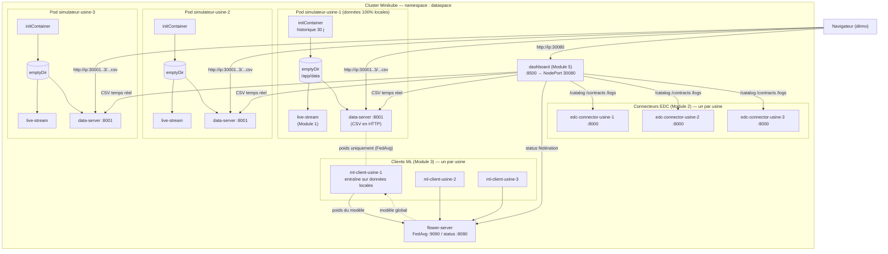

# Architecture Module 4 — Industrial Data Space sur Kubernetes

## Vue d'ensemble



## Souveraineté des données — principe directeur

Chaque usine est un pod autonome dont les données vivent dans un volume
`emptyDir` **local au pod** :

- Aucune base centrale, aucun partage de fichiers entre usines.
- Les clients ML ne transmettent au serveur de fédération que les **poids**
  du modèle (apprentissage fédéré FedAvg) — jamais les relevés capteurs.
- Les connecteurs EDC négocient l'accès aux données selon des politiques
  (contrats) — c'est le Data Space.
- Le dashboard lit les flux par HTTP mais ne stocke rien.

## Composants et responsabilités

| Composant | Image | Rôle | Module |
|---|---|---|---|
| `simulateur-usine-{1,2,3}` | `dataspace/simulateur` | historique + live + serveur CSV | 1 (existant) + 4 |
| `flower-server` | `dataspace/flower-server` | agrégation FedAvg, status HTTP | 3 |
| `ml-client-usine-{1,2,3}` | `dataspace/ml-client` | entraînement local | 3 |
| `edc-connector-usine-{1,2,3}` | `dataspace/edc-connector` | publication/contrats/politiques/journal | 2 |
| `dashboard` | `dataspace/dashboard` | supervision + alertes | 5 |

## Ports et exposition

| Service | Port interne | exposition |
|---|---|---|
| data-server (par usine) | 8001 | NodePort **30001 / 30002 / 30003** |
| flower-server gRPC | 9090 | ClusterIP |
| flower-server HTTP | 8080 | ClusterIP |
| edc-connector (par usine) | 8000 | ClusterIP |
| dashboard | 8500 | NodePort **30080** |

> **Accès depuis Windows (driver docker)** : les NodePorts ne sont pas
> routables depuis l'hôte. Utiliser `minikube service <svc> -n dataspace`
> ou `kubectl port-forward` (voir `scripts/04-status.sh`).

## Chaîne d'intégration (build → deploy)

```
services/<svc>/main.py  ──(02-build-images.sh, build dans le daemon minikube)──▶  image dataspace/<svc>
k8s/*.yaml              ──(03-deploy.sh, kubectl apply)──▶  namespace dataspace
imagePullPolicy: Never  ⇒  aucun registre externe requis
```

Les images sont construites **dans le daemon Docker de Minikube**
(`eval $(minikube docker-env)`), donc pas de push vers Docker Hub :
`imagePullPolicy: Never` force Kubernetes à utiliser l'image locale.

## Cycle de vie des pods simulateur

```
Pod démarre
  └─ initContainer generate_one.py   → 30 j d'historique dans /app/data (8 640 relevés)
  └─ live-stream (live_stream.py)    → append live_data.csv toutes les 5 s
  └─ data-server (serve_data.py)     → GET /usine_N/{live,historical}_data.csv + /healthz
```

Si le pod redémarre, l'emptyDir est réinitialisé et l'historique est régénéré :
le système est auto-suffisant, aucune donnée à monter de l'extérieur.
